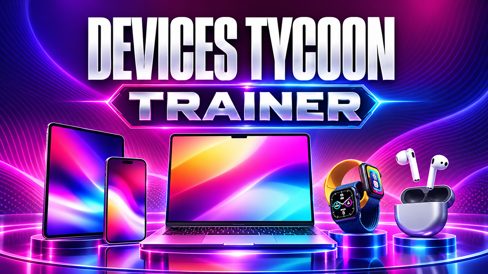

# Devices Tycoon — Trainer

*Run the company without the quarterly maths. Infinite capital, instant R&D, perfect component quality, every engineer hireable, sandbox controls outside sandbox mode.*

    

> **[⬇️ Download the latest Devices Tycoon trainer](../../releases/latest)**

    

[Key reference](#key-reference) &nbsp;|&nbsp; [Questions](#questions-people-actually-ask)

Opens with <kbd>Insert</kbd>. Nothing to install, nothing phones home, source is right here.

Devices Tycoon is offline and solo — there is no lobby, no ladder, no shared economy. Whatever you do in here stays inside your own save file.

---

## Where the hours actually go

Roastery Games built a startup fantasy with a genuinely deep editor underneath it: screen panels, chassis materials, camera sensors, chipsets you can fabricate yourself, an operating system, a graphics card division if you want one. Picking a country, a starting year and a founding budget, then watching a phone you specified yourself land a 7.4 in reviews, is a good hook and the game earns it.

The part that wears thin is the middle. Three or four product cycles in, you already know which component combination the market rewards, and the game still wants you to wait out the research bar, re-staff the office, and sit through another funding crunch before you can build it. A lot of the Steam reviews land on the same word: pacing.

So the two options most people will actually leave on are **instant research** and **no development time** — not infinite money. Money stops being the constraint fairly quickly on its own; the clock never does.

---

## The menu, department by department

### R&D

The device editor is the reason to own this game, so very little here touches design decisions. What it removes is waiting and failed prototypes.

| Setting | Key | Effect |
|---|---|---|
| Instant research | <kbd>F1</kbd> | Technology unlocks the moment it is queued |
| No development time | <kbd>F2</kbd> | Devices finish the second you confirm the spec |
| All components unlocked | — | Every panel, sensor, chipset and material, any year |
| Component quality | slider | `1`–`100` — set the tier instead of researching it |
| Free prototyping | — | Test builds cost nothing |
| No production defects | — | Nothing ships broken |
| Unlimited product lines | — | Past the slot cap |
| Processor fabrication unlocked | — | Includes the graphics card division |

### Finance

| Setting | Key | Effect |
|---|---|---|
| Infinite capital | <kbd>F3</kbd> | The balance stops falling |
| Add funds | slider | `10k`–`500M`, written on press |
| Revenue multiplier | slider | `1x`–`50x` |
| No operating costs | <kbd>F4</kbd> | Salaries, rent, logistics, all zeroed |
| Free marketing | — | Campaigns at any scale |
| Component purchase cost | slider | `0%`–`100%` |
| Instant acquisitions | — | Buy a rival outright, no negotiation |
| Zero warranty claims | — | Returns stop eating margin |

A note on **infinite capital**: it is the obvious button and the least interesting one. Devices Tycoon already hands you a reasonable budget and a forgiving loan system, so switching off money mostly removes the one early-game tension that works. **Add funds** as a one-shot is usually the better call — it gets you out of a bad quarter without deleting the economy for the next forty hours.

### Staff

| Setting | Key | Effect |
|---|---|---|
| Free hiring | <kbd>F5</kbd> | No salaries, no signing costs |
| All candidates available | — | Every designer, programmer and engineer, any country |
| Max skill on hire | — | Everyone arrives at ceiling |
| No morale decay | — | Nobody burns out or resigns |
| Staff work speed | slider | `1x`–`20x` |
| Headcount cap | slider | `10`–`2000` |
| Instant office construction | — | Floors and fit-outs finish on placement |
| All offices unlocked | — | Including the boss office |

Headcount above roughly 400 will slow the simulation before it speeds up your output. Every employee is an entity the game ticks.

### Market

| Setting | Key | Effect |
|---|---|---|
| Reviews always favourable | <kbd>F6</kbd> | Every device scores at the top |
| Review score | slider | `0`–`10` — works downwards too |
| Brand reputation | slider | `0%`–`100%` |
| Sales multiplier | slider | `1x`–`50x` |
| No competitor releases | <kbd>F7</kbd> | Rivals stop shipping against you |
| Competitor strength | slider | `10%`–`300%` |
| Perfect keynote presentations | — | Every reveal lands |
| Always Company of the Year | — | Wins the annual award event |

**Competitor strength** is the one genuinely worth pushing the other way. At `300%` the market stops being a formality and the component choices you have already mastered suddenly matter again. More interesting than switching rivals off.

### Sandbox

Devices Tycoon has a sandbox mode with a configurable starting budget. These extend that to a normal campaign, mid-run.

| Setting | Key | Effect |
|---|---|---|
| Change founding year | dropdown | Jump the timeline forward or back |
| Game speed | slider | `0.25x`–`10x` |
| Freeze the calendar | <kbd>F8</kbd> | Hold the quarter where it is |
| Rewrite company country | dropdown | Changes tax and labour pools |
| Unlock all countries and stores | — | Global footprint, immediately |
| Richest-person ranking position | slider | `1`–`500` |
| Unlock all achievements' prerequisites | — | Not the achievements themselves |

### Workspace

Interface scale `75%`–`200%`, editor zoom past the built-in limit, hide HUD <kbd>F11</kbd>, high-contrast spec sheets, disable notification popups during a build, screenshot mode for your device renders. Plus rolling save backup, read-only mode, achievement blocking, rebindable menu key and overlay opacity.

The interface scale and editor zoom are there for a practical reason: the game came from mobile, and some spec panels are dense at desktop resolution.

---

## Key reference

<kbd>Insert</kbd> menu &nbsp;·&nbsp; <kbd>End</kbd> reset everything &nbsp;·&nbsp; <kbd>↑</kbd><kbd>↓</kbd> rows &nbsp;·&nbsp; <kbd>←</kbd><kbd>→</kbd> sliders &nbsp;·&nbsp; <kbd>Enter</kbd> toggle

<kbd>F1</kbd> instant research &nbsp;·&nbsp; <kbd>F2</kbd> no development time &nbsp;·&nbsp; <kbd>F3</kbd> infinite capital &nbsp;·&nbsp; <kbd>F4</kbd> no operating costs &nbsp;·&nbsp; <kbd>F5</kbd> free hiring &nbsp;·&nbsp; <kbd>F6</kbd> reviews always favourable &nbsp;·&nbsp; <kbd>F7</kbd> no competitor releases &nbsp;·&nbsp; <kbd>F8</kbd> freeze the calendar &nbsp;·&nbsp; <kbd>F11</kbd> hide HUD

All of them rebind.

---

## Two settings worth thinking about first

**The combination most people end up on:** instant research, no development time, component purchase cost at 40%, competitor strength at 150%. The company still has to earn its margins and still has rivals worth beating — you simply stop watching progress bars between the decisions. Four settings, and the editor stays completely untouched.

**The one that empties the game out:** reviews always favourable. Devices Tycoon is, underneath the spreadsheets, a game about whether the thing you specified is any good. A permanent 10 removes the only feedback loop that connects the editor to the outcome, and after two product cycles there is nothing left to aim at. Try it, see what it does, turn it back off.

Settings that write to your save — component unlocks, country changes, headcount caps, ranking position — can be invalidated by a patch. The rolling backup runs by default; leave it on and keep Steam Cloud off while you experiment.

---

## Questions people actually ask

**Is this detectable?** There is nothing to detect it. Devices Tycoon runs offline, has no multiplayer component and ships no anti-cheat. Your save is yours.

**What about Steam achievements?** They fire locally as normal. If you would rather earn them properly, there is a switch in the Workspace section that suppresses them while the menu is attached, and most people keep a separate save for cheated runs.

**Can I change the founding year mid-campaign?** Yes — the Sandbox section exposes it outside sandbox mode. It is the single most requested thing from the mobile version's community and it is the reason that section exists.

**Does it work with the mobile save?** No. The Steam build and the Android or iOS versions use different save formats and different builds entirely. This targets the Steam release only.

**Why did half the options stop responding?** A game update moved the memory addresses. They break independently, so the ones still working are not a fluke. Each release here names the game build it was tested on — match that, or switch on read-only mode to see which values the menu can still read correctly.

**My antivirus quarantined the download.** Reading and writing another running program's memory is, from a scanner's point of view, indistinguishable from what malware does, so heuristic detection fires on tools like this as a matter of course. Checksums are attached to every release and the source is in this repository. Whether you add an exclusion is your call and declining is perfectly sensible.

**Steam Deck or Linux?** Windows desktop only. Running the game through Proton changes the memory layout and this build does not account for that.

---

## If something misbehaves

- **No response to <kbd>Insert</kbd>** — something else owns that key. Steam's overlay, Discord and RTSS are the usual culprits; rebind in the Workspace section.
- **Menu cannot find the game** — the process needs to exist first. Start Devices Tycoon, load a company, then attach.
- **Staff settings do nothing** — they bind per hired employee. Hire at least one, then toggle.
- **R&D settings do nothing** — open the device editor or the research screen first; that memory allocates on entry.
- **The simulation crawled to a halt** — check your headcount cap. Several hundred employees plus a 10x game speed is a lot of entities per tick.
- **Unlocks disappeared after an update** — a persistent write got invalidated. Roll back to a backup from before the patch.

---

## Version history

**1.0.0** — 18 October 2026 — initial build. 50+ settings across R&D, Finance, Staff, Market, Sandbox and Workspace. Save backup runs by default. Review score and competitor strength exposed as sliders rather than switches.

---

## Credits and legal

Devices Tycoon is made by Roastery Games, who shipped it on mobile in 2023 and spent three years turning it into a desktop release. This is an unofficial fan tool with no connection to them or to Valve, and the game's name and assets are theirs.

Editing a live process carries some risk of crashes and corrupted saves. Keep backups. Released under the MIT licence.
